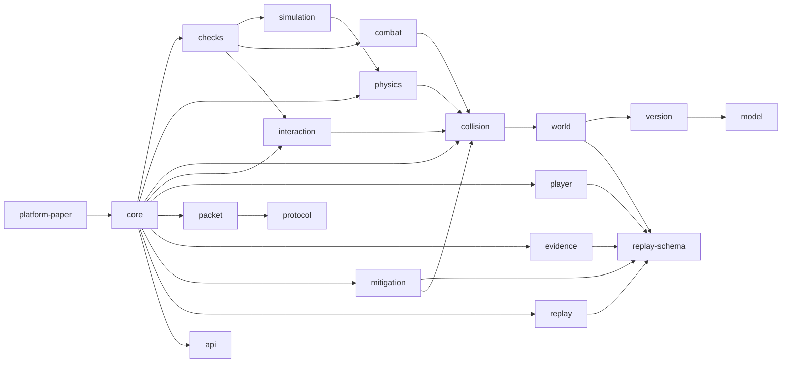

# Architecture

Status: Phase 0 proposal, ready for independent review, not approved for implementation. Normative words MUST and MUST NOT define acceptance obligations. Numeric resource limits are initial design budgets, not measured capacity claims.

## Existing repository and migration

Inspected the requested repository, not the OneDrive working directory. The `master` branch has no commits. Four files were already staged: `.gitignore`, `pom.xml`, `src/main/java/me/nicolas/papea2AC/Papea2AC.java`, and `src/main/resources/plugin.yml`. Ignored `.idea/.gitignore` and `.idea/workspace.xml` are IDE metadata. No tests, Gradle configuration, engine code, or local AGENTS.md were found.

| Existing asset | Assessment | Planned action after review |
|---|---|---|
| Maven POM | Java 21; Spigot 1.21.11; compiler/shading/resource filtering | Preserve now; replace with reviewed Gradle multi-project build in Phase 1 foundation step |
| JavaPlugin entry point | Empty enable/disable hooks; appropriate platform boundary | Move into platform-paper; keep public plugin identity; implement lifecycle only in approved phase |
| plugin.yml | Name Papea2AC, author Emojiado, existing main class, API 1.21 | Preserve identity; update API declaration and runtime requirements against verified target |
| .gitignore | Useful IDE/Maven/build exclusions | Preserve; later add Gradle exclusions and explicitly permit wrapper JAR despite `*.jar` |
| .idea | Local editor state | Leave untouched and ignored |

Migration must be atomic in a later change: establish Gradle wrapper/toolchain and dependency verification, move source/resources without changing identity, build/load the empty plugin, then retire Maven only after comparison passes. Avoid two authoritative builds. No implementation or migration is performed in Phase 0.

## Decision A1: shared engines and composition

**DECISION:** Retain the original 17 module names and add `anticheat-model`, `anticheat-replay-schema` and `anticheat-interaction` (20 total; 19 production). Internal values, archival contracts and action semantics have different consumers/stability requirements from the public integration API. `core` remains the explicit composition root with direct dependencies on every implementation it constructs. `platform-paper` supplies platform ports to core; it does not independently construct physics. `checks` contains consumers and heuristic policies, never independent geometry/physics. `evidence` owns violation aggregation; `simulation` owns input constraints and movement validation; `player` owns state/timeline storage. These changes address Review B1/B2/M12 before any physical module creation.

**WHY:** Each proposed boundary corresponds to a distinct correctness or platform contract. Explicit ownership prevents checks from reconstructing incompatible worlds.

**ALTERNATIVES:** A single plugin module; one module per cheat; additional timeline/violation/input modules.

**TRADEOFFS:** Three additional boundaries add schema translation and build maintenance. They prevent internal types from acquiring public compatibility promises and allow replay to evolve independently. No additional bootstrap module is needed because core can legally perform composition.

## Final intended repository structure

At repository root: `README.md`, `docs/`, `settings.gradle.kts`, `build.gradle.kts`, `gradle.properties`, `gradle/libs.versions.toml`, verified `gradle/wrapper/`, `gradlew`, `gradlew.bat`, and the modules below. Each module eventually has its own build file and conventional source/test directories. Fixture generators and benchmarks belong in `anticheat-testing`; review artifacts and sanitized fixture manifests remain in this repository. Build caches, temporary build output and server test directories must also be configured underneath it when running project automation.

## Dependency graph

Arrow means **consumer depends on provider**. This table is the exhaustive allowed direct project dependency adjacency list, not merely an illustrative graph. All module names have prefix `anticheat-`.

| Module | Allowed direct dependencies | Responsibility |
|---|---|---|
| api | none | Stable, intentional external integration surface only |
| model | none | Internal immutable identities, geometry, coverage and service-port contracts |
| replay-schema | none | Versioned archival DTOs, projection/restore and replay-driver contracts |
| version | model | Rulesets, block behavior definitions, numeric profiles and capability selection |
| protocol | model, version, replay-schema | Internal normalized events and their archival projection |
| packet | model, protocol | Bounded ingress, sequencing abstractions and transport SPI |
| player | model, replay-schema | Component/timeline storage and local snapshot mapper |
| world | model, version, replay-schema | Observer blocks/entities, behavior resolver and local snapshot mapper |
| collision | model, version, world | Shapes, clipping, entity colliders and ray geometry |
| physics | model, version, world, collision | Concrete one-step rules and abstract transfer functions |
| simulation | model, replay-schema, version, player, world, collision, physics | Witness search, interval/constraint solver, envelope and result mapper |
| combat | model, replay-schema, version, player, world, collision | Historical attack scenes and result mapper |
| interaction | model, replay-schema, version, player, world, collision | Placement/use/break/entity interaction semantics and mapper |
| evidence | model, replay-schema | Evidence, cross-engine correlation, violation policy and mapper |
| checks | model, protocol, player, simulation, combat, interaction, evidence | Engine consumers and heuristic feature policies |
| mitigation | model, replay-schema, player, evidence, world, collision | Intent state machine, shared-engine SafeAnchorValidator and mapper |
| replay | replay-schema | Codec, schema diff, capture allocation and replay input driver |
| core | api, model, replay-schema, version, protocol, packet, player, world, collision, physics, simulation, combat, interaction, checks, evidence, mitigation, replay | Composition, orchestration, public-to-internal mapping, configuration and supervision |
| platform-paper | api, model, version, protocol, packet, world, mitigation, core | JavaPlugin, outcome-aware transport, main-thread executor and platform ports |
| testing | all preceding modules, **test/benchmark configurations only** | Fixtures, reference harness, replay runner, load driver |

This ordering is also a topological ordering: every production dependency appears earlier. No production module may depend on testing. Main source sets in testing are empty; test fixtures must not be pulled into release JARs.

All modules except platform-paper are platform-independent. Only platform-paper may import Bukkit, Paper, CraftBukkit, NMS or Netty channel classes. Paper integration tests in testing use a separate test configuration. Dependencies use Gradle `implementation`; signatures exposed across module boundaries require the consumer's explicit direct dependencies. No transitive visibility is assumed. Production never depends on testing. Reflection/service locators cannot bypass the adjacency list.

The diagram summarizes edges using exact table names; the table is exhaustive. Four legal construction/call paths: (1) platform-paper -> core -> collision and physics constructors; (2) core -> mitigation's SafeAnchorValidator -> collision, injected as a model port into the platform executor; (3) checks -> interaction -> world/collision; (4) each state owner's local mapper -> replay-schema DTO -> core -> replay codec/diff, with restore dispatched by core back to those mappers. Replay never imports core or a live state implementation. Destination clearance uses a bounded immutable server-current view constructed on the main thread, then the same pure collision engine, not copied Bukkit geometry rules.

## Decision A3: public API, internal model and archival schema

**DECISION:** `api` exposes only PapeaService, PublicPlayerId, CoverageSummary, EvidenceSummary, scoped ExpiringExemptionRequest and DeclaredEffectNotice to external plugins/staff tooling. Core implements this facade and translates to internal messages. `api` never depends on model or replay-schema. API semantic versions promise documented integration compatibility; internal model has no third-party compatibility promise; replay-schema has independent versioned decode/migration compatibility.

**WHY:** Shared use is not evidence that a type belongs in a public API. Archival and mutable runtime representations evolve at different rates.

**ALTERNATIVES:** Put all shared types in api; serialize implementation classes; let replay import every engine.

**TRADEOFFS:** Explicit local mappers duplicate representation, so round-trip/state-digest tests are mandatory. No annotations or executable objects cross archival or public boundaries.

| Category / example | Declaration owner and boundary |
|---|---|
| Public player identifier | api PublicPlayerId; core maps to model SessionId/epochs |
| Position/vector, AABB, SafeAnchor | model internal immutable values; no public geometry engine |
| Network state and coverage | model immutable summaries; mutable ledgers in player |
| Internal packet event | protocol NormalizedObservation; never exported via api |
| TimelineSlice, component snapshot | player local read projection; archival PlayerSnapshotDto in replay-schema |
| World revision handle | model RevisionId; WorldView and ChunkSectionSnapshot declared by world |
| SimulationInput/Candidate/Result/Error/Uncertainty | simulation module-local engine contracts; consumers have simulation dependency |
| Collision result / query | collision local; model SafeAnchorValidationPort returns a small model ClearanceResult |
| EvidenceRecord, ViolationDecision | evidence local; redacted public EvidenceSummary is separately mapped |
| MitigationIntent | mitigation local; model PlatformEffectRequest is the narrow execution port payload |
| ReplayRecord and all archival DTOs | replay-schema; no pointers, world handles without content closure, or domain implementation imports |

New-type rule: intentionally supported external operation -> api; archival representation -> replay-schema; internal primitive/immutable value or cross-boundary port with a documented owner -> model; engine-specific result/query/mutable state -> owning module. Two consumers alone never qualify. Explicit exclusions from api: SimulationResult, EvidenceRecord, MitigationIntent, WorldView, TimelineSlice, internal packet events and replay records. Model cannot absorb algorithms, codecs, framework types or every engine result.

Integration decisions: external notices and exemptions have plugin identity, scope, sequence, reason and expiry (default maximum 60 seconds, renewed explicitly); they enter actor ordering, never directly mutate state. Notices do not invent an impulse already observed in packets: correlate effect IDs, otherwise mark CustomMovementDeclared and reduce dependent coverage. No reputation/trust multiplier alters proof, reach or physics tolerance. Explicit exemptions suppress actions and remain visible/audited. Read-only coverage queries start in Phase 1; declarations/exemptions in Phase 2 before custom movement qualification. See [Configuration](CONFIGURATION.md).

## Decision A2: outcome semantics

**DECISION:** Observation -> validation -> evidence -> violation -> mitigation is a typed sequence. Validation returns VALID, UNCERTAIN or INVALID plus completeness and reasons. VALID means at least one supported legitimate explanation was found, not proof of honest intent. INVALID requires every admissible explanation to be excluded with complete relevant knowledge. UNCERTAIN cannot accrue punitive movement/combat violation weight.

**WHY:** Missing knowledge, incomplete search and unusual behavior are different facts.

**ALTERNATIVES:** Boolean check result; weighted suspicion for every mismatch.

**TRADEOFFS:** Deliberate ambiguity can reduce coverage. Resource/network anomalies are measured separately and may trigger availability controls, never fabricated cheating evidence.

## System flow and contracts

Network ingress -> immutable semantic event -> connection sequencer -> player actor -> timeline/state reducer -> observer world/latency views -> collision/physics and input reconstruction -> engine validation -> evidence -> violation policy -> mitigation intent -> main-thread platform executor -> execution acknowledgement back to the same sequencer.

Each stage has an explicit session epoch, sequence and ruleset identity. Replay taps normalized inputs, external outcomes and deterministic decisions, not arbitrary live Java objects. Administrative readers receive immutable published summaries. Commands/configuration updates re-enter the sequence as messages.

Security boundary: all client values are untrusted. Capture is not server acceptance; [Packet pipeline](PACKET_PIPELINE.md) defines correlated outcomes before certified frontier promotion. ACK receipt is not application. Plugin-generated server changes do not prove client application. Uncovered transforms/cancellation boundaries disable dependent certification. Configuration is owned by core and projected canonically as documented in [Configuration](CONFIGURATION.md).

Migration checklist (Phase 1 only): preserve `name: Papea2AC`, `authors: [Emojiado]`, `main: me.nicolas.papea2AC.Papea2AC`, and initial version `1.0-SNAPSHOT`; select Java toolchain 25; replace Spigot with a pinned qualified Paper API. Set plugin.yml api-version to the exact value documented/supported by that selected API (expected 26.x, not a guessed literal; gate unresolved until selection). Add `!gradle/wrapper/gradle-wrapper.jar` after `*.jar`; verify a clean clone builds. Keep the existing files byte-identical during remediation.

## Documentation map

[Packet pipeline](PACKET_PIPELINE.md), [thread ownership](THREADING_MODEL.md), [state](PLAYER_STATE.md), [timeline](PLAYER_TIMELINE.md), [world](WORLD_MODEL.md), [collision](COLLISION_ENGINE.md), [simulation](MOVEMENT_SIMULATION.md), [input reconstruction](INPUT_RECONSTRUCTION.md), [latency](LATENCY_COMPENSATION.md), [combat](COMBAT_MODEL.md), [evidence](EVIDENCE_MODEL.md), [mitigation](MITIGATION.md), [replay](REPLAY_SYSTEM.md), [testing](TESTING.md), [performance](PERFORMANCE.md), [versions](VERSION_SUPPORT.md), [AI workflow](AI_DEVELOPMENT_RULES.md), [Intave comparison](INTAVE_REFERENCE_ANALYSIS.md), [roadmap](ROADMAP.md), [review gates](PHASE_0_REVIEW.md).
