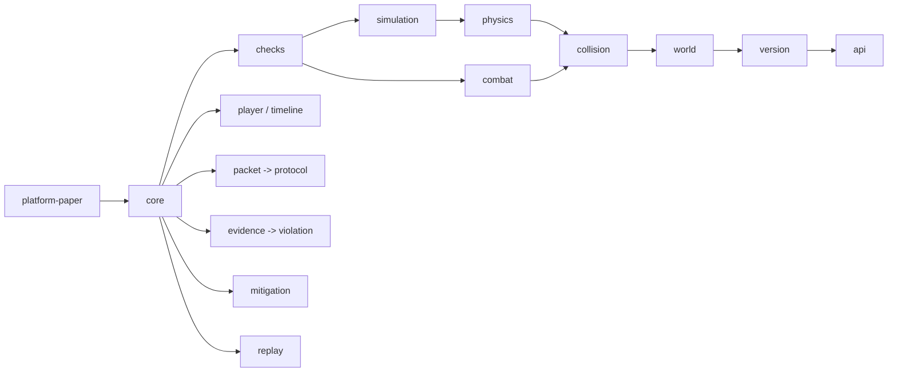

# Architecture

Status: Phase 0 proposal, ready for independent review, not approved for implementation. Normative words MUST and MUST NOT define acceptance obligations. Numeric resource limits are initial design budgets, not measured capacity claims.

## Existing repository and migration

Inspected the requested repository, not the OneDrive working directory. The `master` branch has no commits. Four files were already staged: `.gitignore`, `pom.xml`, `src/main/java/me/nicolas/papea2AC/Papea2AC.java`, and `src/main/resources/plugin.yml`. Ignored `.idea/.gitignore` and `.idea/workspace.xml` are IDE metadata. No tests, Gradle configuration, engine code, or local AGENTS.md were found.

| Existing asset | Assessment | Planned action after review |
|---|---|---|
| Maven POM | Java 21; Spigot 1.21.11; compiler/shading/resource filtering | Preserve now; replace with reviewed Gradle multi-project build in Phase 1 foundation step |
| JavaPlugin entry point | Empty enable/disable hooks; appropriate platform boundary | Move into platform-paper; keep public plugin identity; implement lifecycle only in approved phase |
| plugin.yml | Name Papea2AC, author Emojiado, existing main class, API 1.21 | Preserve identity; update API declaration and runtime requirements against verified target |
| .gitignore | Useful IDE/Maven/build exclusions | Preserve; later add Gradle exclusions and explicitly permit wrapper JAR despite `*.jar` |
| .idea | Local editor state | Leave untouched and ignored |

Migration must be atomic in a later change: establish Gradle wrapper/toolchain and dependency verification, move source/resources without changing identity, build/load the empty plugin, then retire Maven only after comparison passes. Avoid two authoritative builds. No implementation or migration is performed in Phase 0.

## Decision A1: shared engines and composition

**DECISION:** Retain all 17 proposed module names. `core` is the composition/orchestration layer; engines do not depend on it. `checks` contains consumers and heuristic feature policies, not independent physics. `evidence` also owns violation aggregation. `simulation` owns input reconstruction and movement validation. `player` owns state/timeline storage. Add documentation files for roadmap and review, not extra runtime modules.

**WHY:** Each proposed boundary corresponds to a distinct correctness or platform contract. Explicit ownership prevents checks from reconstructing incompatible worlds.

**ALTERNATIVES:** A single plugin module; one module per cheat; additional timeline/violation/input modules.

**TRADEOFFS:** Seventeen modules impose build and API maintenance. Additional modules would fragment initially small contracts. Revisit only with dependency evidence and a new decision record.

## Final intended repository structure

At repository root: `README.md`, `docs/`, `settings.gradle.kts`, `build.gradle.kts`, `gradle.properties`, `gradle/libs.versions.toml`, verified `gradle/wrapper/`, `gradlew`, `gradlew.bat`, and the modules below. Each module eventually has its own build file and conventional source/test directories. Fixture generators and benchmarks belong in `anticheat-testing`; review artifacts and sanitized fixture manifests remain in this repository. Build caches, temporary build output and server test directories must also be configured underneath it when running project automation.

## Dependency graph

Arrow means **consumer depends on provider**. This table is the exhaustive allowed direct project dependency adjacency list, not merely an illustrative graph. All module names have prefix `anticheat-`.

| Module | Allowed direct dependencies | Responsibility |
|---|---|---|
| api | none | Immutable contract values, IDs, capabilities, result/port interfaces |
| version | api | Pure rulesets, registries and capability selection |
| protocol | api, version | Normalized event schemas, semantic packet interpretation |
| packet | api, protocol | Bounded ingress and sequencing abstractions; transport SPI |
| player | api | Component ownership, epoch state, timeline and immutable snapshots |
| world | api, version | Observer-specific block/entity history and immutable world views |
| collision | api, version, world | Shape queries, movement clipping, ray geometry |
| physics | api, version, world, collision | Pure one-step movement rules |
| simulation | api, version, player, world, collision, physics | Candidate generation, reconstruction, validation |
| combat | api, version, player, world, collision | Observer-relative historical attack/interaction validation |
| evidence | api | Evidence records, correlation and violation policy |
| checks | api, protocol, player, simulation, combat, evidence | Engine adapters, timer/velocity/behavioral consumers |
| mitigation | api, player, evidence | Intent policy and setback state machine, no platform calls |
| replay | api, protocol, version | Versioned records, encoding/decoding, input/output ports |
| core | api, version, protocol, packet, player, world, simulation, combat, checks, evidence, mitigation, replay | Lifecycle, actor reducers, dispatch and dependency injection |
| platform-paper | api, version, protocol, packet, world, mitigation, core | JavaPlugin, transport integration, main-thread bridge, platform effects |
| testing | all preceding modules, **test/benchmark configurations only** | Fixtures, reference harness, replay runner, load driver |

This ordering is also a topological ordering: every production dependency appears earlier. No production module may depend on testing. Main source sets in testing are empty; test fixtures must not be pulled into release JARs.

All modules except platform-paper are platform-independent. Only platform-paper may import Bukkit, Paper, CraftBukkit, NMS or Netty channel classes. Paper integration tests in testing may use Paper in a separate integration-test configuration. `api` has no Paper, packet-library or serializer annotations. Domain implementation results remain in their owning modules; only cross-boundary immutable projections enter named API packages (`identity`, `observation`, `state`, `geometry`, `validation`, `evidence`, `ports`). An API package must have at least two legitimate consumers; do not turn it into a utility dump.

The diagram summarizes the runtime-oriented dependencies; the table governs all edges. Ports invert runtime callbacks: replay never imports core; core supplies a reducer to the offline runner. The platform implements mitigation execution ports without mitigation importing the platform. Player snapshots use API value types and world revision handles, not mutable world implementations.

## Decision A2: outcome semantics

**DECISION:** Observation -> validation -> evidence -> violation -> mitigation is a typed sequence. Validation returns VALID, UNCERTAIN or INVALID plus completeness and reasons. VALID means at least one supported legitimate explanation was found, not proof of honest intent. INVALID requires every admissible explanation to be excluded with complete relevant knowledge. UNCERTAIN cannot accrue punitive movement/combat violation weight.

**WHY:** Missing knowledge, incomplete search and unusual behavior are different facts.

**ALTERNATIVES:** Boolean check result; weighted suspicion for every mismatch.

**TRADEOFFS:** Deliberate ambiguity can reduce coverage. Resource/network anomalies are measured separately and may trigger availability controls, never fabricated cheating evidence.

## System flow and contracts

Network ingress -> immutable semantic event -> connection sequencer -> player actor -> timeline/state reducer -> observer world/latency views -> collision/physics and input reconstruction -> engine validation -> evidence -> violation policy -> mitigation intent -> main-thread platform executor -> execution acknowledgement back to the same sequencer.

Each stage has an explicit session epoch, sequence and ruleset identity. Replay taps normalized inputs, external outcomes and deterministic decisions, not arbitrary live Java objects. Administrative readers receive immutable published summaries. Commands/configuration updates re-enter the sequence as messages.

Security boundary: all client values are untrusted; acknowledgements constrain possible client state but do not prove honest simulation. Plugin-generated server changes are authoritative server observations, not proof that a client has applied them. Third-party packet transformations require compatible final-wire observation or affected validation is disabled with a reason.

## Documentation map

[Packet pipeline](PACKET_PIPELINE.md), [thread ownership](THREADING_MODEL.md), [state](PLAYER_STATE.md), [timeline](PLAYER_TIMELINE.md), [world](WORLD_MODEL.md), [collision](COLLISION_ENGINE.md), [simulation](MOVEMENT_SIMULATION.md), [input reconstruction](INPUT_RECONSTRUCTION.md), [latency](LATENCY_COMPENSATION.md), [combat](COMBAT_MODEL.md), [evidence](EVIDENCE_MODEL.md), [mitigation](MITIGATION.md), [replay](REPLAY_SYSTEM.md), [testing](TESTING.md), [performance](PERFORMANCE.md), [versions](VERSION_SUPPORT.md), [AI workflow](AI_DEVELOPMENT_RULES.md), [Intave comparison](INTAVE_REFERENCE_ANALYSIS.md), [roadmap](ROADMAP.md), [review gates](PHASE_0_REVIEW.md).
